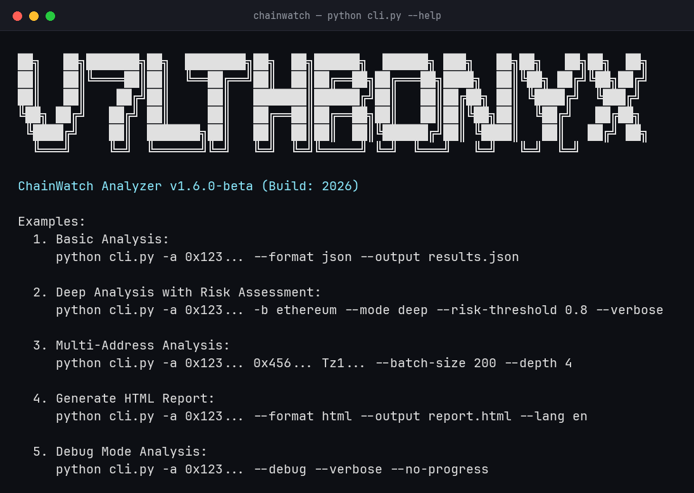

# ChainWatch Analyzer 1.6.0-beta
<div dir="rtl">

## معرفی
چین‌واچ یک ابزار تحلیل و نظارت هوشمند بر تراکنش‌های بلاکچین است که با استفاده از هوش مصنوعی و یادگیری ماشین، الگوها و رفتارهای مشکوک را شناسایی می‌کند. این ابزار از چندین شبکه بلاکچین پشتیبانی می‌کند و قابلیت‌های پیشرفته‌ای برای تحلیل تراکنش‌ها ارائه می‌دهد.

### ویژگی‌های اصلی
- تحلیل چند زنجیره‌ای تراکنش‌ها
- شناسایی الگوهای مشکوک
- امتیازدهی ریسک
- تحلیل توپولوژی شبکه
- تشخیص ناهنجاری‌ها
- شناسایی مسیرهای تبادل
- پشتیبانی از زبان فارسی و انگلیسی

### نصب و راه‌اندازی
</div>

---

## Introduction
ChainWatch is an intelligent blockchain transaction analysis and monitoring tool that uses artificial intelligence and machine learning to identify suspicious patterns and behaviors. This tool supports multiple blockchain networks and provides advanced capabilities for transaction analysis.

### Key Features
- Multi-chain transaction analysis
- Suspicious pattern detection
- Risk scoring
- Network topology analysis
- Anomaly detection
- Exchange path identification
- Bilingual support (English/Persian)

### Installation

```bash
git clone https://github.com/v74all/Chainwatch.git
cd Chainwatch
pip install -r requirements.txt
```

### Screenshot

<p align="center">
  
</p>

<div dir="rtl">

## پیکربندی
برای استفاده از برنامه، فایل `.env` را در مسیر اصلی پروژه ایجاد کرده و کلیدهای API مورد نیاز را در آن قرار دهید:
</div>

## Configuration
Create a `.env` file in the project root and add your API keys:

```env
TRON_API_KEY_1=your_tron_api_key_1
TRON_API_KEY_2=your_tron_api_key_2
ETHERSCAN_API_KEY=your_etherscan_api_key
BLOCKCYPHER_TOKEN=your_blockcypher_token
# ... other API keys
```

<div dir="rtl">

## نحوه استفاده
برنامه را می‌توانید از طریق خط فرمان با گزینه‌های مختلف اجرا کنید:
</div>

## Usage
You can run the program through command line with various options:

```bash
# Basic Analysis / تحلیل پایه
python cli.py -a 0x123... --format json --output results.json

# Deep Analysis with Risk Assessment / تحلیل عمیق با ارزیابی ریسک
python cli.py -a 0x123... -b ethereum --mode deep --risk-threshold 0.8 --verbose

# Multi-Address Analysis / تحلیل چند آدرس
python cli.py -a 0x123... 0x456... Tz1... --batch-size 200 --depth 4

# Generate HTML Report / تولید گزارش HTML
python cli.py -a 0x123... --format html --output report.html --lang fa

# System Health Check / بررسی سلامت سیستم
python cli.py --health-check
```

<div dir="rtl">

## پارامترهای خط فرمان
</div>

## Command Line Parameters

```
Required Arguments:
  -a, --addresses        One or more wallet addresses to analyze

Analysis Configuration:
  -b, --blockchain      Specific blockchain to analyze (ethereum/bsc/tron/etc)
  -d, --depth           Analysis depth (default: 3)
  --mode               Analysis mode (quick/deep)
  --risk-threshold     Risk threshold (0.0-1.0)
  --batch-size         Batch size for processing

Output Options:
  -o, --output         Output file path
  -f, --format         Output format (json/csv/html)

Additional Options:
  --verbose           Enable detailed output
  --lang              Interface language (en/fa)
  --no-progress       Disable progress bars
  --debug             Enable debug mode
  --health-check      Run system health check
```

<div dir="rtl">

## بلاکچین‌های پشتیبانی شده
</div>

## Supported Blockchains

- Ethereum (ETH)
- Binance Smart Chain (BSC)
- Tron (TRX)
- Solana (SOL)
- Polygon (MATIC)
- Avalanche (AVAX)
- Cardano (ADA)
- Fantom (FTM)
- Arbitrum (ARB)
- Optimism (OP)
- And many more...

<div dir="rtl">

## نمونه خروجی
برنامه خروجی تحلیل را در قالب‌های مختلف ارائه می‌دهد:
</div>

## Sample Output
The program provides analysis output in various formats:

```json
{
  "address": "0x123...",
  "blockchain": "ethereum",
  "risk_score": 75.5,
  "fraud_probability": 0.85,
  "suspicious": true,
  "analysis_details": {
    "risk_factors": [
      "High-value transactions: 15%",
      "Rapid transactions: 25%",
      "Suspicious connections: 3"
    ],
    "statistics": {
      "total_transactions": 150,
      "total_volume": 1250.45,
      "unique_counterparties": 45
    }
  }
}
```

### `--mode deep` aggregate report

With `--mode deep`, the output also includes an `aggregate_report` section built across every address analyzed in that run: network centrality and clustering, statistical/behavioral anomaly detection, temporal risk patterns, and generated recommendations.

```json
{
  "aggregate_report": {
    "summary": { "total_transactions": 320, "unique_addresses": 18 },
    "risk_analysis": { "network_risks": { "clustering_coefficient": 0.42 } },
    "network_analysis": { "flow": { "density": 0.37, "diameter": 3 } },
    "anomaly_detection": { "behavioral": { "suspicious_addresses": ["0x..."] } },
    "recommendations": ["Investigate and address blacklist presence"]
  }
}
```

<div dir="rtl">

## آموزش الگوریتم یادگیری ماشین
برای بهبود دقت تشخیص تراکنش‌های مشکوک، می‌توانید الگوریتم یادگیری ماشین را با داده‌های خود آموزش دهید:

### نیازمندی‌های داده آموزشی
- فایل CSV حاوی تراکنش‌های برچسب‌گذاری شده
- هر تراکنش باید شامل: آدرس کیف پول، زمان، مقدار و برچسب (مشکوک/عادی) باشد
- حداقل 1000 تراکنش برای آموزش مؤثر توصیه می‌شود

### مراحل آموزش مدل
1. آماده‌سازی داده‌ها:
   - داده‌ها را در فرمت CSV ذخیره کنید
   - برچسب‌های مشکوک را با 1 و عادی را با 0 مشخص کنید
   - داده‌ها را به دو بخش آموزش و آزمایش تقسیم کنید

2. تنظیم پیکربندی:
   - فایل `config/training_config.yaml` را ویرایش کنید
   - پارامترهای مدل را تنظیم کنید
   - نوع مدل را انتخاب کنید

3. اجرای آموزش:
   ```bash
   python scripts/train_model.py --data data/transactions.csv --output models/
   ```

4. ارزیابی مدل:
   - گزارش عملکرد را بررسی کنید
   - مدل را در صورت نیاز بهینه‌سازی کنید
</div>

## Training the Machine Learning Algorithm
To improve the accuracy of suspicious transaction detection, you can train the ML algorithm with your own data:

### Training Data Requirements
- CSV file containing labeled transactions
- Each transaction must include: wallet address, timestamp, amount, and label (suspicious/normal)
- Minimum of 1000 transactions recommended for effective training

### Training Process
1. Data Preparation:
   - Save data in CSV format
   - Mark suspicious transactions with 1, normal with 0
   - Split data into training and test sets

2. Configuration Setup:
   - Edit `config/training_config.yaml`
   - Configure model parameters
   - Select model type

3. Run Training:
   ```bash
   python scripts/train_model.py --data data/transactions.csv --output models/
   ```

4. Model Evaluation:
   - Review performance report
   - Optimize model if needed
